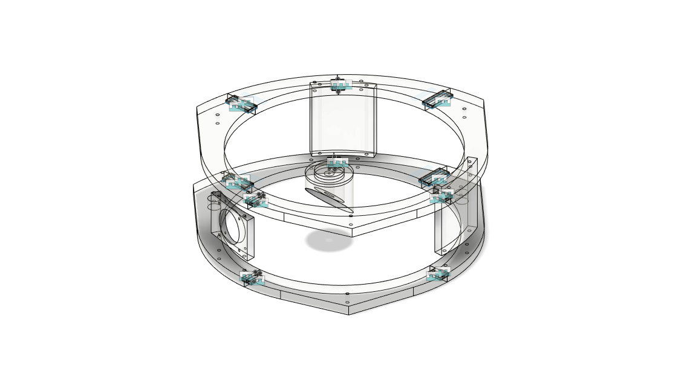

# 16" DobStuff Dob rebuild: from a 3D-printed cage to a GoTo truss scope

I bought a 16" strut Dobsonian kit from Dennis Steele at [DobStuff](https://dobstuff.blogspot.com/) and
assembled it at the start of 2022 (Hubble Optics 16" f/3.9 sandwich mirror, 9-point cell, three struts with
strings and a single upper ring).

## Phase 1: 3D-printed upper cage (retired)

The first goal was more adjustability for the focuser and secondary, so I designed a printed cage for the
secondary mirror and focuser (`cagev11.f3d`). It didn't hold up, and that version is kept here for reference only.

## Phase 2: GoTo rebuild (current)

The current design turns the scope into a visual-first GoTo and tracking Dob that holds collimation from
horizon to zenith, sets up in about 20 minutes without tools, and fits in a Kia EV6.

- **Upper cage:** two solid 3/8" 6061 rings on four 3/4" posts, with a push-pull focuser board for the
  Feather Touch FTF2015 and a straight 4-vane spider (0.5 mm stainless) anchored on the posts.
- **Secondary:** a 3.5" mirror in a self-aligning holder. It is bonded to a carrier in a gluing jig, doweled to the
  45° body, and has a dew heater.
- **Truss:** six 1" aluminium poles in three pre-joined pairs, laid out as a wide-pair octahedron. They sit in
  cone sockets on stub tubes in the DobStuff mirror cage's existing holes, with nine knobs and no tools.
- **Mirror cage and cell:** the DobStuff cage and 9-point cell are kept, with push-pull collimation.
- **Drives:** a SiTech Servo II with Pittman GM9413 (altitude) and GM9213 (azimuth) motors. Each axis has a
  GT2 belt glued on its rim (the 14" altitude bearing and a 30" azimuth ground ring), giving 112:1 and 120:1.
  Magnetic-tape encoders, a Nexus DSC Pro, and plate solving through the "Waypoint" finder.
- **Optics:** focal plane 11.9" from the secondary, so a coma corrector sits mid-travel.

The model predicts the focal point drifts about 0.02 mm (cage and spider) plus about 0.09 mm (truss) between
horizon and zenith, inside the 0.5 mm collimation tolerance at f/3.9.

| Where | What |
| --- | --- |
| [`docs/design.md`](docs/design.md) | Full design doc: decisions, reviews, error budget, build plan (exported) |
| [Living design doc](https://claude.ai/code/artifact/a2bd133b-cebf-4c55-a572-9a930c1ab10f) | Source of truth for the doc |
| [3D viewer](https://claude.ai/artifact/J1dg2GqFYWfny88NzJT5gF) | Interactive model (altitude slider, spider and truss options) |
| [`goto-rebuild/`](goto-rebuild/) | Parametric CadQuery model, stiffness (FE) studies, and STEP/DXF/GLB outputs |

## Status

The design is reviewed down to the drives. Before anything is cut, these dimensions still need measuring on
the actual scope: the angle of the mirror cage tube holes, the ring sizes, the altitude bearing radius, the
rocker, the FTF2015 bolt circle, and whether the cell is bonded. The full list is under "Open measurements" in
[`docs/design.md`](docs/design.md).
