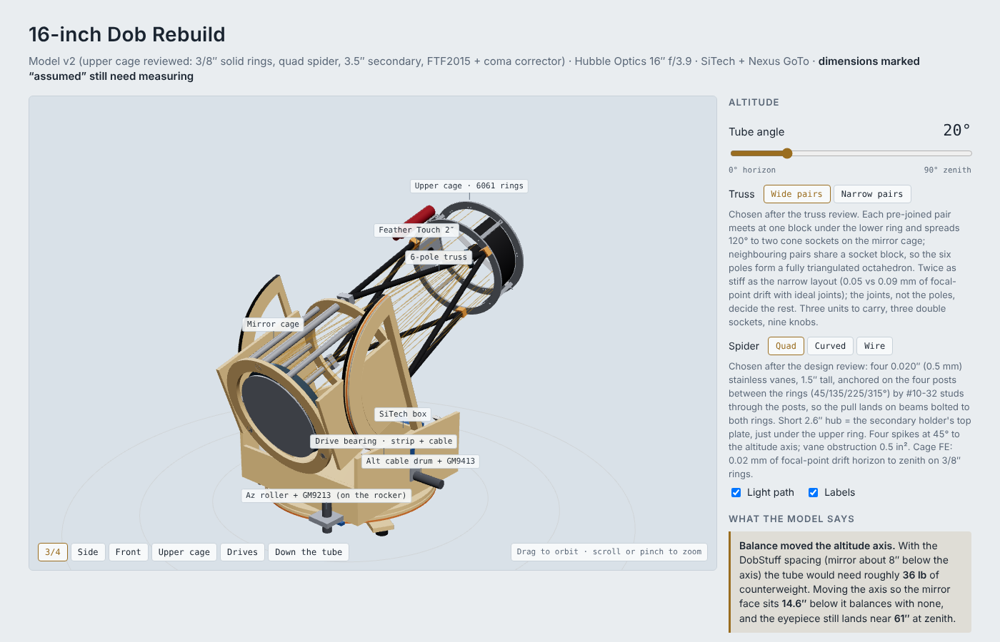
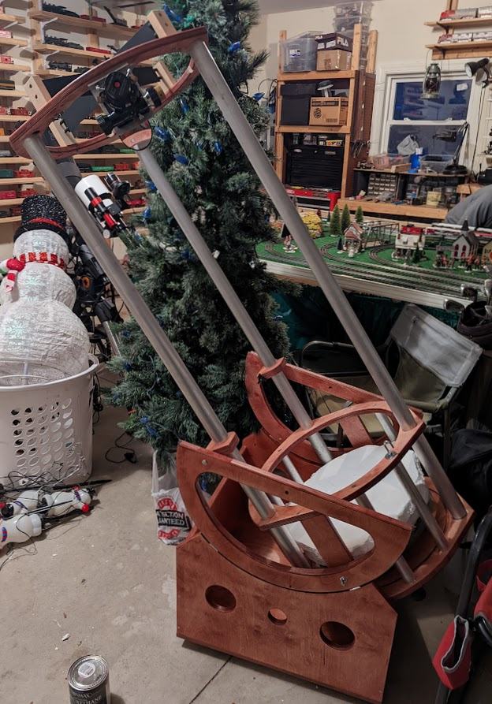

# 16" GoTo Dobsonian rebuild

A visual-first GoTo and tracking rebuild of a 16" f/3.9 DobStuff strut Dobsonian. The goals: collimation
that holds from horizon to zenith, setup in about 20 minutes with no tools, and a scope that travels in a
Kia EV6.



| | |
| --- | --- |
| [Living design doc](https://claude.ai/code/artifact/a2bd133b-cebf-4c55-a572-9a930c1ab10f) | Decisions, reviews, error budget, build plan (source of truth) |
| [`docs/design.md`](docs/design.md) | Markdown export of the design doc |
| [3D viewer](https://claude.ai/artifact/J1dg2GqFYWfny88NzJT5gF) | Interactive model: altitude slider, spider and truss options, phone friendly |
| [`goto-rebuild/`](goto-rebuild/) | Parametric CadQuery model, FE studies, STEP/DXF/GLB outputs |
| [`CLAUDE.md`](CLAUDE.md) | Full project context for Claude sessions |

## The scope

The base is a DobStuff 16" strut kit from Dennis Steele, assembled in 2022. It has a Hubble Optics 16" plate-glass
sandwich mirror (406 mm, about 42 mm thick, 10.5 kg) in a 9-point non-flotation cell. The mirror cage has two
3/4" plywood rings, six short spacer tubes and two side panels. Originally three 1.25" struts and strings ran
up to a single upper ring.



## Design at a glance

| Subsystem | Design |
| --- | --- |
| Optics | f/3.9, FL about 62.4". 3.5" secondary, offset 0.22" per axis, 11.9" from the focal plane. A coma corrector is always in the focuser (Explore Scientific HR or Paracorr 2). |
| Upper cage | Two solid 3/8" 6061 rings (17.5" ID, 20.5" OD, 7.5" clear between them) on four 3/4" square posts at 45/135/225/315°. A 1/4" focuser board on rails with push-pull tilt. Feather Touch FTF2015. |
| Spider | Straight 4-vane: 0.020" (0.5 mm) stainless vanes, 1.5" tall, anchored on the four posts with #10-32 tension studs. The hub is the secondary holder's top plate. |
| Secondary holder | Self-aligning. The mirror is bonded to a carrier in a gluing jig, then doweled to a 45° body. Push-pull tilt, ±4° clocking slots, and a dew heater run by the Pegasus Pocket Powerbox. |
| Truss | Wide-pair octahedron: three pre-joined pairs of 1" × 0.058" 6061 poles about 30" long. Pair blocks under the cage at 30/150/270°; cone sockets on stub tubes in the mirror cage's holes at 90/210/330°. Nine knobs, no tools. |
| Mirror cage and cell | DobStuff cage kept. The 9-point cell is kept, with push-pull collimation in place of springs. |
| Altitude bearings | 14" radius D, two laminated layers of 3/4" Baltic birch. Ebony Star running on PTFE pads at ±35°. Doweled. The drive side carries the belt and an encoder tape. |
| Drives | SiTech Servo II. GT2 belt glued teeth-out on each rim, sprung 20T pinion, 2:1 stage. Altitude: GM9413, 112:1. Azimuth: GM9213 mounted on the rocker, driving a 30" ground ring, 120:1. Magnetic-tape encoders on both axes. |
| Pointing | Nexus DSC Pro. A mini PC runs ASCOM and plate solving. "Waypoint" plate-solving finder: WO UniGuide 50 with a ToupTek G3M662C. |
| Power and wiring | 12 V LiFePO4 through a regulator (the Pegasus trips above about 14 V). A cage hub joins a USB3 + 12 V trunk that crosses the altitude axis at the bearing flat. |

**Predicted collimation hold, horizon to zenith:**

| Source | Drift at the focal plane |
| --- | --- |
| Cage and spider | 0.02 mm |
| Truss (good joints) | about 0.09 mm |
| Cell | about 0.1 mm |
| **Total** | **about 0.2 mm** |

The tolerance at f/3.9 is 0.5 mm.

## Status

The design has been reviewed from the cage down to the drives. Nothing is cut yet. These still need
measuring on the real scope:

- angle of the mirror cage's three tube holes relative to the bearings, and the tube OD
- mirror cage ring sizes and height
- altitude bearing radius and pad positions
- rocker and ground board
- FTF2015 bolt circle
- whether the cell is silicone-bonded

The open list lives in the design doc.

## Run the model

```
cd goto-rebuild
pip install cadquery numpy matplotlib
python dob_model.py      # whole scope + balance solve -> out/
python export_cage.py    # upper cage fit checks, DXF/STEP
python export_holder.py  # secondary holder + gluing jig
python cage_fe.py quad   # cage + spider collimation FE
python truss_fe.py       # truss FE
python build_site.py     # viewer bundle -> dist/
```

Fabrication: AltMill 2×4 for aluminium and plywood, LongMill and a Voron Trident for jigs and small parts.
